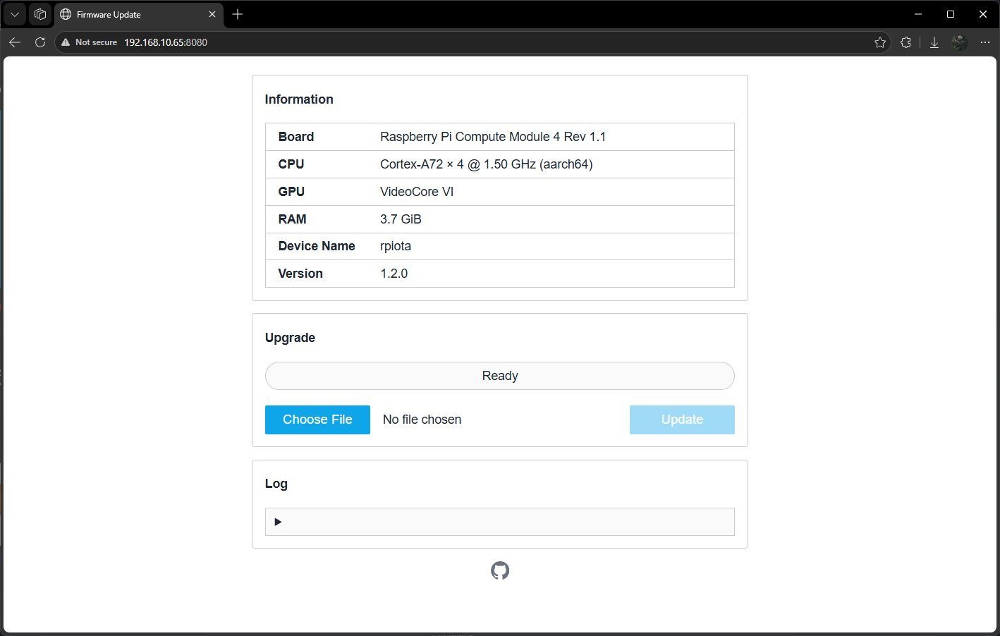

# Rpiota
不依靠Raspberry Pi Connect服務，透過rpi-image-gen產生Image後，使用自製網頁在上傳 & 更新OTA鏡像。

## 檔案結構
```text
Rpiota/
├── docs/                 文件與截圖
├── image/                映像建置
│   ├── build.sh
│   ├── install.sh
│   ├── config/
│   ├── layer/
│   └── systemd/
├── ota/
│   ├── rpiota/           裝置端程式與打包工具
│   ├── web/              更新網頁
│   └── tests/
├── app/                  範例程式（Hello OTA）
└── README.md             專案簡介與文件連結
```

## 網頁介面


## 連結

- [架構](docs/architecture.md)
- [映像建置](image/README.md)
- [如何產生更新包](docs/build-update-bundle.md)
- [設計](docs/superpowers/specs/2026-11-26-simple-ota-design.md)
- [rpi-image-gen](https://github.com/raspberrypi/rpi-image-gen)
