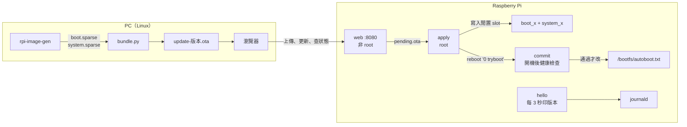

# 架構

在瀏覽器選更新檔、按 `Update`，Pi（CM4）把新系統寫到閒置的 slot 並試開機一次。健康檢查通過才保留，否則回到舊版。映像用 [rpi-image-gen](https://github.com/raspberrypi/rpi-image-gen) 的 `image-rota` 建置。

> **只適合實驗網路。** 沒有簽章、沒有登入，連得到 port 8080 的人都能把任意系統映像裝到裝置上。

## 元件



| 元件 | 身分 | 工作 |
|---|---|---|
| `app/hello.py` | 一般服務 | 每 3 秒印 `Hello OTA <版本>`，用來確認目前跑的是哪一版；獨立範例，裝在 `/opt/app/` |
| `web.py` + `web/index.html`、`web/app.js` | 非 root | 英文頁面：顯示版本與裝置名稱、選更新檔、按 Update、進度條與 log 窗（Pure.css，亮色） |
| `apply.py` | root | 檢查雜湊、機型、版本、大小，寫入閒置 slot，試開機 |
| `commit.py` | root | 開機後確認服務正常才改 `autoboot.txt`，否則回滾 |
| `bundle.py` | PC 與裝置 | 打包與檢查更新檔 |
| `sparse.py` | 裝置 | 把 `*.sparse` 映像寫進分割區 |

## 一次更新

1. 按 `Choose File` 選 `.ota`，再按 `Update`。
2. 頁面上傳檔案（`upload.ota`），接著自動改名為 `pending.ota`，systemd 啟動 `apply`。
3. `apply` 寫完閒置 slot 後執行 `reboot "0 tryboot"`。
4. 新系統開機，`commit` 檢查服務。通過就設為預設；失敗或 180 秒逾時就重開回舊版。

每一步都顯示在頁面下方的 log 窗。log 只存在瀏覽器分頁裡，重新整理就清空。

## 分割區

沿用 `image-rota`：`bootconfig`、`boot_a`／`boot_b`、`system_a`／`system_b`、`persistent`。更新只換系統，`persistent` 保留。

## 建置

在 arm64 的 Debian／Raspberry Pi OS 上：

```bash
RPIOTA_VERSION=1.0.0 RPIOTA_SSH_PUBKEY=~/.ssh/id_ed25519.pub bash image/build.sh
```

第一次要先跑 `bash image/build.sh --deps`，細節見 [映像建置](../image/README.md)。

## 測試

需要 Python 3.13 與 PATH 上的 `zstd`，Linux 與 Windows 都能跑：

```bash
python3 -m unittest discover -s ota/tests -t ota
```

Windows 上指令是 `python`。測試輸出中的錯誤堆疊來自故意製造失敗的案例，以最後一行 `OK` 為準。

分割區用一般檔案代替，重開機與 systemd 用假函式代替。**映像還沒有實際建置過，也沒有在實機驗證過。**
