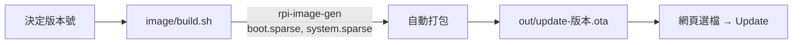

# 如何產生更新包（`.ota`）

在建映像的主機上做，環境需求見 [映像建置](../image/README.md)。以下指令都在專案根目錄執行。



## 一個指令

```bash
RPIOTA_VERSION=1.0.1 RPIOTA_SSH_PUBKEY=~/.ssh/id_ed25519.pub bash image/build.sh
```

完成後更新包在 `out/update-1.0.1.ota`。版本號與建置時間戳會同時寫進映像和更新包，不用另外設定。裝置只接受建置時間比目前映像新的包。

## 只重新打包

建置成功、但更新包遺失時，可以從同一次建置的輸出重做。`--version` 與 `--epoch` 必須和那次映像裡的值相同；`epoch` 在建置目錄的映像內（裝置上是 `/etc/rpiota/epoch`），也寫在原本更新包的 manifest。

```bash
PYTHONPATH=ota python3 -m rpiota.bundle \
  --image-dir ~/rpi-ota-work/image-rpiota \
  --version 1.0.1 --epoch <建置時間戳> --out update-1.0.1.ota
```

| 參數 | 說明 |
|---|---|
| `--image-dir` | 含 `boot.sparse` 與 `system.sparse` 的目錄 |
| `--version` | 要和映像內的版本相同 |
| `--epoch` | 要和映像內的時間戳相同 |
| `--out` | 輸出檔名 |
| `--device-class` | 預設 `cm4` |

## 檢查內容

```bash
tar -tf out/update-1.0.1.ota
tar -xOf out/update-1.0.1.ota manifest.json
```

應依序列出 `manifest.json`、`boot.sparse.zst`、`system.sparse.zst`。不要手動重新打包：項目順序或內容改變，裝置會拒收。

## 上傳

瀏覽器開 `http://rpiota.local:8080`，按 `Choose File` 選 `.ota`，再按 `Update`。log 窗依序顯示上傳、版本號、檢查、寫入百分比和重開機；裝置會自己重開，最後顯示 `Update succeeded.` 或失敗原因。更新期間不要關閉分頁，否則看不到先前的 log。

## 第一次燒錄

`.ota` 只能更新已經在跑 A/B 映像的裝置。第一次要燒完整映像 `~/rpi-ota-work/image-rpiota/rpiota.img` 到 SD 卡（16 GB 以上）。

## 錯誤代碼

| 代碼 | 原因 | 處理 |
|---|---|---|
| `bad_bundle` | 不是更新包，或上傳不完整 | 重新打包、重新上傳 |
| `bad_hash` | 內容損毀 | 重新上傳 |
| `wrong_device` | 機型不符 | 用正確的 `--device-class` 打包 |
| `not_newer` | 建置時間沒有比目前映像新 | 重新建置 |
| `too_large` | 映像大於分割區 | 調整 `image/config/ota.yaml` 的大小 |
| `write_failed` | 寫入失敗 | 看 `journalctl -u rpiota-apply` |
| `interrupted` | 寫入中斷電 | 重新上傳 |
| `health_failed` | 新版本服務沒起來 | 看 `health.units` 內的服務 |
| `commit_failed` | 新版本已開機，但設為預設時出錯 | 接序列主控台重新更新，看 `rpiota-commit` 的錯誤訊息（回到舊版後不一定查得到新版的紀錄） |
| `rolled_back` | 新版本無法開機 | 接序列主控台查看 |
| `no_space` | `persistent` 空間不足 | 清出空間 |
